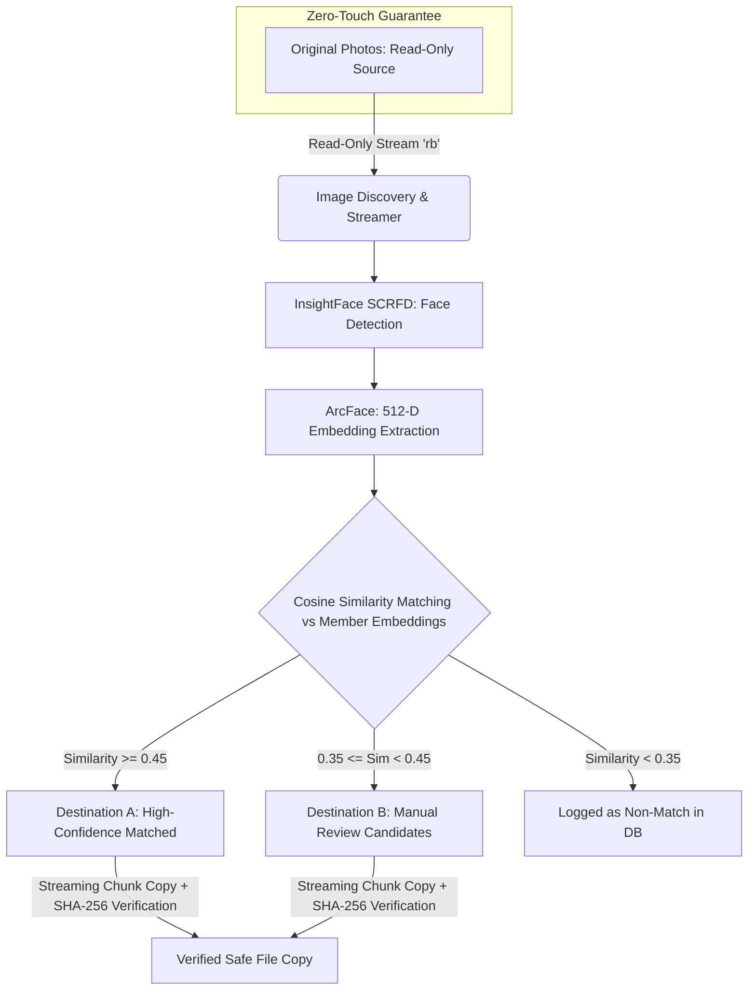

# AI Family Photo Sorter 📸🔍

[](https://www.python.org/)
[](https://fastapi.tiangolo.com/)
[](https://github.com/deepinsight/insightface)
[](https://onnxruntime.ai/)
[]()
[]()

An intelligent, fully-local, privacy-first desktop web application designed to scan thousands of high-resolution wedding and event photographs, detect and recognize individual family members using state-of-the-art deep learning face recognition, and sort them into organized destination folders without ever modifying your original images.

**Everything runs 100% on your local machine. No cloud uploads. No external APIs. No telemetry. Zero internet required after setup.**

---

## 🛡️ Zero-Touch Source Folder Safety Guarantee

When working with irreplaceable wedding, family, or historical photographs, **data preservation is the highest priority**. The application is architecturally designed around a strict **Zero-Touch Policy**:

1. **Read-Only Binary Access**: Every source image is opened strictly in binary read mode (`open(path, 'rb')`) or loaded as a read-only numpy buffer (`np.fromfile(...)`). 
2. **Never Modified, Moved, or Deleted**: The engine **never** invokes `os.remove()`, `os.rename()`, `shutil.move()`, or any file truncation/write methods on the source folder.
3. **Strict Folder Isolation**: Built-in folder validation (`validate_folders()`) guarantees that:
   - Destination folders cannot be set to the Source folder.
   - Destination folders cannot be located inside the Source directory.
   - The Source folder cannot be placed inside Destination directories.
4. **Byte-for-Byte Cryptographic Verification**:
   - Matches are copied to destination folders in streaming chunks (never overwriting existing files).
   - Collision-safe naming (`filename_1.jpg`) ensures no files are lost if duplicate names exist across subdirectories.
   - The file size and **SHA-256 cryptographic hash** of both the source and newly created destination file are compared. A copy is only confirmed if the hashes match 100%.

---

## ✨ Key Features

- **State-of-the-Art Deep Learning Recognition**:
  - Powered by **InsightFace `buffalo_l`** with **SCRFD** face detection and **ArcFace (ResNet-100)** 512-dimensional metric embeddings.
  - Robust against challenging lighting, profile angles, partial occlusions, group photos, and varying focal lengths.
- **Dynamic Family Member Management**:
  - Add, rename, or delete custom reference profiles (e.g., *Me*, *Mother*, *Father*, *Sister*, *Groom*, *Bride*, *Grandparents*, *Guests*).
  - Multi-reference photo fusion: Upload 3–8 diverse reference photos per member to build a generalized, high-accuracy facial identity vector.
- **Interactive In-Browser Folder Browser**:
  - Clean visual directory explorer integrated into the web UI.
  - Browse system drives (`C:\`, `D:\`, etc.), traverse folders, view breadcrumbs, and select folders with a single click.
- **Real-Time Active Session Dashboard**:
  - Live progress tracking showing images scanned, matches found, review candidates, and current scanning speed (images/second).
  - Dynamic **Estimated Time Remaining (ETA)** calculation.
  - Interactive **Pause**, **Resume**, and **Stop** controls that automatically tuck away once processing completes.
- **Two-Tier Sorting Pipeline**:
  - **Destination A (High Confidence)**: Verified matches exceeding the strict similarity threshold (`≥ 0.45`).
  - **Destination B (Review / Ambiguous)**: Borderline matches (`0.35 ≤ similarity < 0.45`) or low-resolution face detections routed for quick manual review with cropped face thumbnails.
- **Crash Recovery & Resume**:
  - Progress and processed hashes are continuously tracked in local SQLite database.
  - If interrupted or stopped, resuming skips already-scanned images instantly without duplicate processing or duplicate copies.

---

## 🏗️ Architecture & Processing Pipeline



---

## 💻 Hardware Requirements & Optimization

The system auto-detects available hardware and configures the optimal execution provider:

| Component | Minimum | Recommended | Tested Configuration |
|-----------|---------|-------------|----------------------|
| **OS** | Windows 10/11 (64-bit) / Linux / macOS | Windows 10/11 (64-bit) | Windows 11 (64-bit) |
| **GPU** | CPU only (fallback) | NVIDIA GPU (4GB+ VRAM) | NVIDIA GeForce GTX 1650 (4 GB) |
| **CUDA Driver**| N/A (for CPU) | CUDA 11.8+ / 12.x | CUDA 11.7 / 12.x compatible |
| **RAM** | 8 GB System RAM | 16 GB System RAM | 8 GB System RAM |
| **Python** | Python 3.10 or 3.11 | Python 3.10 | Python 3.10.0 |
| **Speed** | ~2–5 images/sec (CPU) | ~12–25 images/sec (GPU) | ~15 images/sec |

*Memory-Optimized for 8 GB RAM: Images are loaded and released sequentially one-by-one. Large photos (>4096px) are dynamically downscaled in-memory only for detection, while original files are always copied byte-for-byte.*

---

## 🚀 Quick Start Guide

### 1. Clone the Repository
```bash
git clone https://github.com/aibinjmca2527-dotcom/-Auto-Photo-Sorter.git
cd -Auto-Photo-Sorter
```

### 2. Run Automated Setup
Double-click `setup.bat` or run:
```bash
setup.bat
```
This script will:
- Verify Python version (3.10+ recommended) and `pip`.
- Install dependencies from `requirements.txt`.
- Set up ONNX Runtime with GPU acceleration (or fallback to CPU).
- Download the InsightFace `buffalo_l` face recognition model weights.
- Run `setup_check.py` to confirm model and database integrity.

*Manual Pip Install alternative:*
```bash
pip install -r requirements.txt
python setup_check.py
```

### 3. Launch the Application
Double-click `launch.bat` or run:
```bash
launch.bat
```
The FastAPI server will start and automatically launch your default browser at:
```
http://127.0.0.1:8000
```

---

## 📖 Step-by-Step Usage

### Step 1: Configure Folders
1. Navigate to the **Setup** tab.
2. Select your **Source Folder** (where your original wedding photos are stored). Use the visual **Browse...** button to navigate your folders.
3. Select **Destination A** (for high-confidence matches).
4. Select **Destination B** (for review candidates).

### Step 2: Add Family Members & Reference Photos
1. Under **Family Member References**, view the default profiles or click **Add Member** to create a new person.
2. Click **Add Reference Photo** for each member.
3. Select 3–8 diverse, high-quality, front-facing reference photos of that individual.
4. Green indicators confirm the face was successfully detected and registered.

### Step 3: Start the Scan
1. Navigate to **Scan Dashboard** and click **Start Scan**.
2. Monitor real-time speed, elapsed time, ETA, and sorted counts.
3. Pause, Resume, or Stop the scan anytime with zero data loss.

### Step 4: Review and Verify
1. **Matched Gallery**: Browse photos that were confidently matched and verified.
2. **Review Screen**: Quickly approve or reject uncertain faces with side-by-side face crops.
3. **Reports**: View complete audit logs or export scan results to CSV.

---

## 🔒 Privacy & Public Repository Security

This repository is configured to safeguard privacy:
- **Zero Cloud Leakage**: All computation is performed offline on `localhost`.
- **Pre-configured `.gitignore`**:
  - All image file extensions (`*.jpg`, `*.jpeg`, `*.png`, `*.webp`, `*.raw`, `*.cr2`, etc.) are excluded from git.
  - Storage directories (`reference_photos/`, `thumbnails/`, `test_dataset/`) are strictly untracked.
  - SQLite databases (`photo_sorter.db*`) containing personal biometric embeddings and file histories are never committed.
  - Environment files, credentials, and local system logs are permanently ignored.

---

## 🧪 Automated Testing

The project includes an automated test suite verifying face matching, similarity thresholds, folder isolation, collision handling, and cryptographic hash copy integrity.

Run the test suite:
```bash
python tests.py
```
```
.............................................
----------------------------------------------------------------------
Ran 45 tests in 3.421s

OK
```

---

## 📁 Project Structure

```
AI_PHOTO FINDER/
├── main.py                 # FastAPI backend REST API and lifecycle management
├── face_engine.py          # InsightFace ArcFace + SCRFD detection and embedding engine
├── scan_worker.py          # Multithreaded scan controller and resume logic
├── file_ops.py             # Safe streaming copy, folder validation, SHA-256 verification
├── database.py             # SQLite schema and SQLAlchemy session management
├── setup_check.py          # Environment, hardware, and model diagnostic script
├── create_test_dataset.py  # Benchmark test dataset generator with synthetic faces
├── tests.py                # Comprehensive automated unit and integration tests
├── requirements.txt        # Python package dependencies
├── setup.bat               # Windows one-click environment installer
├── launch.bat              # Windows one-click application launcher
├── .gitignore              # Privacy protection ignoring all images, DBs, and media
└── frontend/
    ├── index.html          # Modern glassmorphism SPA layout
    ├── style.css           # Premium dark-mode design system & animations
    └── app.js              # State management, folder browser, live dashboard updater
```

---

## 📜 License & Credits

- Face recognition models provided by [InsightFace](https://github.com/deepinsight/insightface) under their respective non-commercial research/personal license.
- Backend powered by [FastAPI](https://fastapi.tiangolo.com/) and [ONNX Runtime](https://onnxruntime.ai/).
